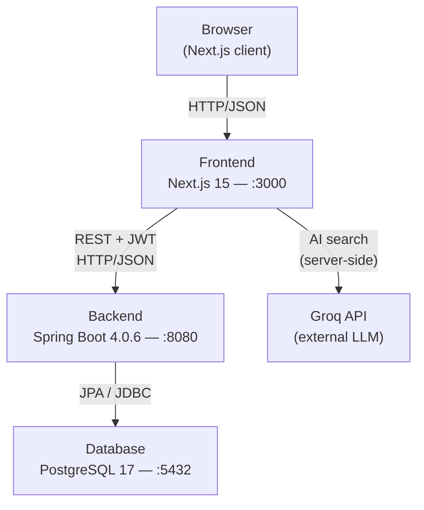

# Architecture

## Overview

Kapotiabi is a three-tier web application: a Next.js frontend, a Spring Boot REST API backend, and a PostgreSQL database. All three run as separate Docker containers orchestrated with Docker Compose.

---

## Component Diagram

---

## Request Lifecycle

1. **Browser** sends a request to Next.js (port 3000).
2. For page renders, Next.js serves HTML/JS. For API calls, the browser calls the Spring Boot backend directly on port 8080.
3. **Spring Security** intercepts every request:
   - Paths under `/api/v1/auth/**` are public.
   - Swagger/OpenAPI documentation endpoints are also public.
   - All other application paths, including `/api/v1/guest-estimates/**`, require a valid JWT in the `Authorization: Bearer` header.
   - `/api/v1/admin/**` additionally requires `ROLE_ADMIN`.
4. `JwtAuthenticationFilter` validates the token, extracts the user ID and role, and sets the `SecurityContext`.
5. **Controllers** delegate to **Services** which enforce ownership rules using `SecurityUtils.getAuthUserId()`.
6. **Repositories** (Spring Data JPA) execute SQL against PostgreSQL.
7. **Flyway** runs all migrations in order at startup before the application accepts traffic.

---

## AI Search

The AI-powered repair search is handled entirely server-side in a Next.js API route (`/api/chat`). The browser sends the user's natural-language query to Next.js; Next.js calls the Groq API and streams the response back. The Spring Boot backend is not involved.

---

## Key Design Decisions

**Stateless JWT auth** — no sessions or cookies. Every request is self-contained. Enables horizontal scaling of the backend without shared session storage.

**Role-based access + IDOR prevention** — user and owner IDs are always extracted from the JWT (`SecurityUtils.getAuthUserId()`), never accepted from request bodies. This prevents any user from impersonating another by crafting a request with a foreign ID.

**Flyway for schema management** — all schema changes are versioned SQL migrations. The database schema is the source of truth; JPA is set to `validate` (not `create` or `update`) so it fails fast if the entity mapping diverges from the schema.

**Single Spring profile for local dev** — the `dev` profile (`application-dev.yaml`) supplies secrets that are required in production via environment variables, keeping production config clean while making local development zero-config.

**Separate Docker service per concern** — `db`, `backend`, and `frontend` are independent containers. The backend waits for `db` via `depends_on`; the frontend waits for the `backend`.
