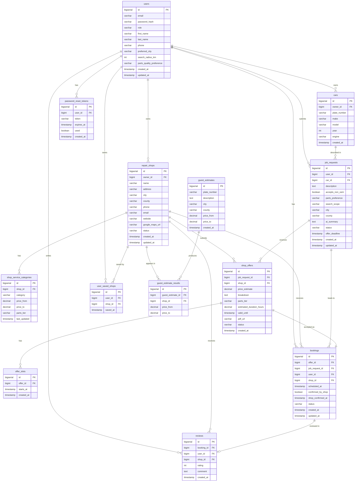

# Database

PostgreSQL 16. Schema managed by Flyway — migrations live in `backend/src/main/resources/db/migration/`.

---

## ER Diagram

---

## Tables

| Table | Description |
|---|---|
| `users` | All user accounts — car owners, shop owners, and admins |
| `cars` | Vehicles registered by car owners |
| `repair_shops` | Shop profiles created when a shop owner registers |
| `shop_service_categories` | Service types and price ranges advertised by a shop |
| `job_requests` | A car owner's repair request, open for offers |
| `shop_offers` | An offer submitted by a shop in response to a job request |
| `offer_slots` | Available appointment time slots attached to an offer |
| `bookings` | Created when a car owner accepts an offer (1-to-1 with offer) |
| `reviews` | Post-service review left by a car owner (1-to-1 with booking) |
| `user_saved_shops` | Bookmarked shops per user |
| `password_reset_tokens` | Single-use tokens for the forgot-password flow |
| `guest_estimates` | Price enquiries submitted without an account |
| `guest_estimate_results` | Per-shop price results for a guest estimate |

---

## Migrations

| Version | Description |
|---|---|
| V1 | Core schema — all main tables |
| V2 | `password_reset_tokens` table |
| V3 | Seed admin user |
| V4 | `user_saved_shops` table + index |
| V5 | User preference columns on `users` |
| V6 | FK indexes for query performance |
| V7 | `offer_slots` table |
| V8 | Status check constraints |
| V9 | Remove hardcoded admin; admin is now seeded at startup via `ADMIN_DEFAULT_PASSWORD` |
