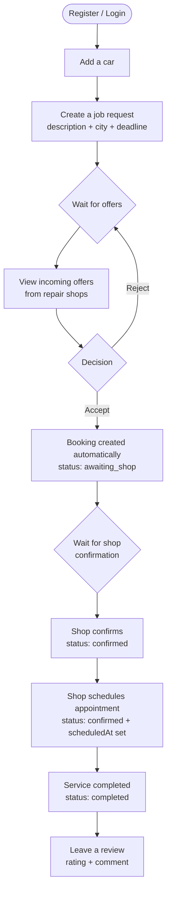
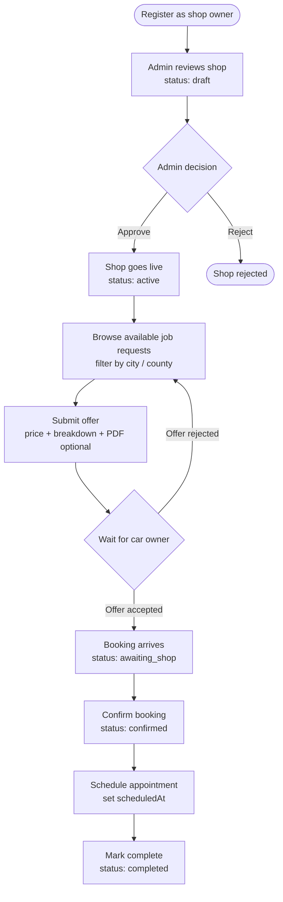
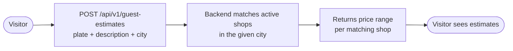
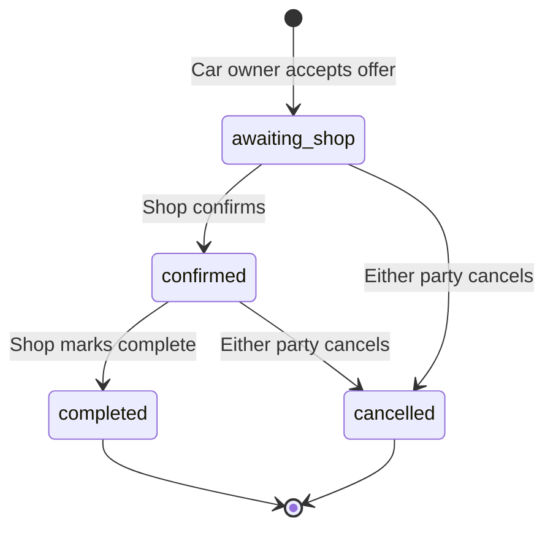
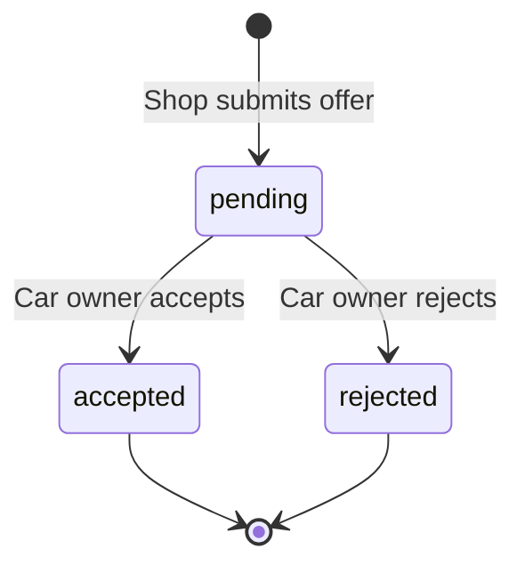
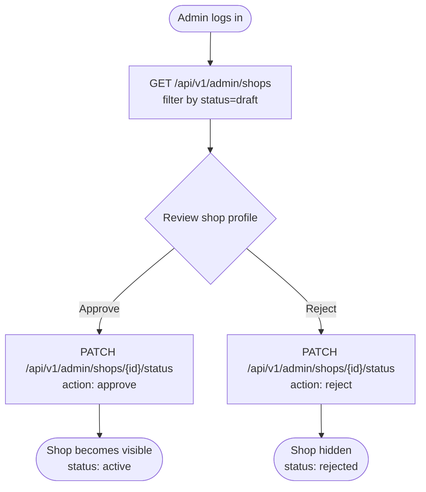

# Application Flow

End-to-end user journeys through Kapotiabi.

---

## Main Flow — Car Owner

---

## Main Flow — Shop Owner

---

## Guest Estimate Flow

No account required.

---

## Booking Status Lifecycle

---

## Offer Status Lifecycle

---

## Admin Flow

